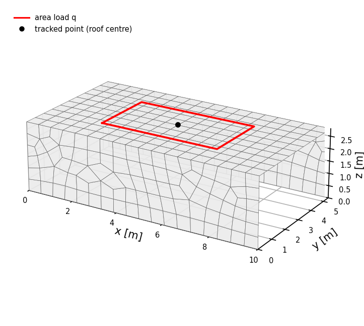

# Deployment: ML-based nonlinear FEA of reinforced concrete shells

This folder uses the trained surrogate model of [`../training`](../training/README.md) as a hybrid surrogate model for the
layered shell finite element model (**ML-NLFEA**) and compares it with the nonlinear FEA using the layered
section model of [`../sampling`](../sampling/README.md) (**NLFEA**). Two applications are included: a table of plate
case studies under in-plane, bending and combined loading (Section 3.2.3 in the paper), and the load path of a frame bridge (Section 4.4 in the paper).

## Contents

1. [Method](#1-method)
2. [Installation](#2-installation)
3. [Usage](#3-usage)
   - 3.1 [Load-path table](#31-load-path-table-run_load_path_tablepy)
   - 3.2 [Frame bridge](#32-frame-bridge-run_frame_bridgepy)
   - 3.3 [Other structures](#33-other-structures)
     - 3.3.1 [Changes without a new mesh topology](#331-changes-without-a-new-mesh-topology)
     - 3.3.2 [Changes with a new mesh](#332-changes-with-a-new-mesh)
4. [Output](#4-output)
5. [Code structure](#5-code-structure)
6. [Notes](#6-notes)

## 1. Method

1. **Model**: 4-node shell elements with 6 DOF per node (membrane, bending and transverse shear), meshed with gmsh.
   Each element is integrated with 2 x 2 Gauss points; the section is divided into 20 layers.
2. **Element formulation at Integration Point**:
   - *NLFEA*: per layer, the in-plane stresses follow from the layered RC model of the sampling 
     (`sampling/utils/constitutive_laws.py`); integrated over the thickness
     they give the generalised stresses `[n_x, n_y, n_xy, m_x, m_y, m_xy]`. The tangent stiffness is obtained with the
     complex-step method.
   - *NN*: the trained network gives the generalised stresses directly from the generalised strains and the section
     `[t, rho_xtop, rho_xbot, rho_ytop, rho_ybot, fc, fs]`; the tangent stiffness is the Jacobian of the network
     (including symmetric averaging). Transverse shear is linear elastic in both models.
3. **Solution**: Newton-Raphson iteration with the tangent stiffness, starting from the linear elastic solution. A
   load level has converged when the largest residual force is below `res_tol`, otherwise the iteration stops after
   `numit` steps. Load levels are applied one after the other; each starts from the converged state of the previous
   one (or from the linear elastic solution if the previous level did not converge).
4. **Comparison**: every load path is computed with the ML-NLFEA and the NLFEA; strains, curvatures and displacements are
   compared over the load levels that converged in both.

## 2. Installation

Use the conda environment of the repository root (see [`../README.md`](../README.md#installation)). The deployment
needs `gmsh`, `numpy`, `scipy`, `torch`, `matplotlib` and `openpyxl` (Excel table), and imports the sampling and
training code of this repository (`sampling/utils`, `training/utils`). It runs on the CPU; the NN forward pass uses
the GPU if available.

## 3. Usage

```bash
cd deploying

# load-path table (plate case studies), default: example case 3D-8, isotropic section
python run_load_path_table.py

# frame bridge
cd frame_bridge
python run_frame_bridge.py
```

The trained model is read from `training/trained_models/v_156` (`model_dir`, `model_version` in the configs).

### 3.1 Load-path table (`run_load_path_table.py`)

Settings in [`config_load_path_table.py`](config_load_path_table.py):

| Setting | Default | Meaning |
| --- | --- | --- |
| `cases`, `geoms` | `['3D-8']`, `['iso']` | case studies and cross-sections to evaluate (`'all'` for the full table) |
| `run` | `True` | `True`: run the selected pairs; `False`: rebuild the table from the latest run folders; list of `(case, section)`: re-run only these |
| `GEOMS` | `iso`, `aniso` | cross-sections `[t, rho_xtop, rho_xbot, rho_ytop, rho_ybot, fc, fs]` |
| `PLATE` | 6 x 6 m, mesh 600 mm | plate dimensions and mesh size |
| `capacity`, `fractions`, `load_levels` | | load levels: `sign * capacity * fractions`, or explicit levels per pair |
| `numit`, `res_tol`, `res_tol_case` | 12, 5 | iterations per load level, convergence tolerance (per-pair override) |
| `symm_predict` | `True` | mid-plane symmetry wrapper of the NN |
| `m_tol` | 0.02 | tolerance of the converged-level check of the table (see below) |
| `table_max` | `{}` | cut-off load level per pair for the table (without re-running) |

The case studies (fixed in `run_load_path_table.py`) are square plates with uniform edge loads, according to Table 3 of the paper:

| Case | Load | Case | Load |
| --- | --- | --- | --- |
| 3D-1 | pure shear | 2D-1C | anticlastic bending |
| 3D-2 / 3D-3 | tension / compression in y | 2D-2C | synclastic bending |
| 3D-4 / 3D-5 | tension / compression in x | 2D-3C / 2D-4C | anticlastic / synclastic bending + torsion |
| 3D-6 | pure torsion | 2D-5C / 2D-6C | as 2D-3C / 2D-4C + in-plane forces |
| 3D-7 / 3D-8 | bending in y / in x | 2D-7C | torsion + normal forces |

Since the stress field of these cases is homogeneous, the table compares the values at the plate centre. A load level
counts as converged if the stress resultants there match the applied field within `m_tol`; the table uses the
leading load levels converged in both NN and NLFEA and reports the maximum load reached, the RMSE(NN, NLFEA) and the
maximum NLFEA value of `eps`, `chi` and `u`.

The example run (3D-8, isotropic, 10 load levels) takes about 2 min; the full table (30 load paths) takes several
hours.

### 3.2 Frame bridge (`run_frame_bridge.py`)



Two walls (t = 400 mm) and a top slab (t = 450 mm), L = 10 m, B = 5.4 m, H = 2.8 m, walls clamped at their base, area
load `q` on the middle of the slab. Each area has three sub-panels with their own reinforcement, set in [`frame_bridge_geom.py`](frame_bridge/frame_bridge_geom.py) with the keys
`rho<x|y>_<top|bot>_<area><panel>` (likewise `fc_<area><panel>`, `fs_<area><panel>`; default: the global values).

Settings in [`config_frame_bridge.py`](frame_bridge/config_frame_bridge.py): `fc` = 16.3 MPa, `fs` = 440 MPa,
`q` = 0.05 ... 0.38 N/mm2, solver settings as above. The script prints the iterations and the remaining residual per
load level (relative to the load: about 1e-5 NN, 1e-3 NLFEA; the bridge usually uses all `numit` iterations) and plots
the load path at the roof centre. Run time about 8 min; outputs in `deploying/data_out` and
`deploying/plots_frame_bridge`.

### 3.3 Other structures

The model is defined in `input_definition` of [`fea_utils/Mesh_gmsh_vb.py`](fea_utils/Mesh_gmsh_vb.py), selected by the
scenario number `mat['s']`. The sections named below are the numbered comments in that function.

#### 3.3.1 Changes without a new mesh topology

- **Plates** (table): plate size and mesh size in `PLATE`, cross-sections in `GEOMS`, load levels in `capacity` /
  `load_levels` of [`config_load_path_table.py`](config_load_path_table.py).
- **Frame bridge**: copy the folder `frame_bridge/` (e.g. to `my_bridge/`) and adjust `L`, `B`, `H`, the thicknesses
  `t_11` / `t_12`, the per-region reinforcement and `ROOF_CENTRE` in the copied `frame_bridge_geom.py`, and the
  material and load levels in the copied config. The mesh follows `L`, `B`, `H` and the mesh size `ms`. The sub-panel
  boundaries (H/3, H/2, B/8, 7B/8) are set in section *4.11 Geometrical Information per Element*.
- **Other supports or loads** need a new scenario: add a block `elif scenario == <new number>:` in section
  *2 Loads and Boundary Conditions*, following the existing ones:
  - `BC`: one row per support region `[xmin, xmax, ymin, ymax, zmin, zmax, ux, uy, uz, thx, thy, thz]`, prescribed
    value of each DOF or `1234` for a free DOF;
  - `Load_n` / `Load_el`: nodal / element loads per load level, rows
    `[xmin, xmax, ymin, ymax, zmin, zmax, direction (1-6), magnitude]`, scaled with `Force_mag[i]` (load level).

  For the table, add the case to `_CASES` in `run_load_path_table.py` (scenario, sign, `'n'` / `'m'`) and its
  capacity or load levels in the config. Load levels are converted to forces with `F = level * L`, or
  `F = level * L * B` for area loads (frame bridge; `run_load_path` in `run_utils/load_path_utils.py` and
  `load_level_label` in `fea_utils/Main_vb_vec.py`): add the new scenario there if its load level is an area load.

#### 3.3.2 Changes with a new mesh

A new geometry gets its own branch in section *1 Define Geometry and Mesh with gmsh* of `input_definition`
(`if scenario == SCENARIO_FB: ... else: ...`), built like the frame bridge block:

1. **Points** (`gmsh.model.geo.addPoint(x, y, z, ms)`) and **lines** (`addLine`) of all flat areas; areas that meet
   share the same lines, so that the mesh is connected.
2. **Areas**: one curve loop per area (`addCurveLoop`), `na` = number of areas.
3. **Local coordinate systems**: origin `O[a]` and local x- / y-axes `LS[a]` (points `[origin, x, y]`) per area; the
   local x / y directions are the directions of the reinforcement and of `eps_x`, `eps_y`.
4. **Mesh size and layers** per area (`mesh`, `nl`) and the plane surfaces (`addPlaneSurface`).

Meshing (section 1.9: quadrilaterals, triangles where needed), assembly and solution need no changes. Then define the
supports and loads of the new scenario in section 2 (see 3.3.1). One thickness and one reinforcement layout apply to
all areas by default; per-area or per-region values can be added in section 4.11, as for the frame bridge
(`_t_wall` / `_t_top`, `_panel_idx`).

## 4. Output

Run data (one folder per load path, not tracked by git):

```
deploying/data_out/data_<timestamp>_<case>_<section>_v156/      (table)
deploying/data_out/data_<timestamp>_FB_v156/                     (frame bridge)
    <load level>/mat_res_NN.pkl       NN-based FEA
    <load level>/mat_res_norm.pkl     NLFEA
    <load level>/conv_plots/          convergence plot per iteration (conv_plt_<i>NN.png, conv_plt_<i>NLFEA.png)
```

`mat_res` holds the model (`NODESG`, `ELEMENTS`, `COORD`, `MATK`, `GEOMK`, ...), the displacements (`ux` ... `thz`),
the generalised strains / stresses at the element centres (`eps_g`, `sig_g`), the post-processed fields (`POST`),
the residuals per iteration (`convrf`, `convrm`) and the intermediate solutions of all iterations (`u_cum`, `sh_cum`,
`eh_cum`, `De_cum`).

Table and figures:

| Script | File | Content |
| --- | --- | --- |
| `run_load_path_table.py` | `plots_load_path_table/Load_path_table_v156_<timestamp>.xlsx` | sheet `Table` (layout of the paper), sheet `Data` (one row per load path) |
|  | `plots_load_path_table/Load_path_table_v156_<timestamp>.csv` | = sheet `Data` |
|  | `plots_load_path_table/<case>_<section>/Load-Deformation_2x2_<case>_<section>.png` | load vs. displacements / rotations (plate-centre node) and strains / curvatures (plate-centre element), NN dashed, NLFEA solid; mesh with the tracked points |
|  | `plots_load_path_table/<case>_<section>/residual_loadlevel_<case>_<section>.png` | residual forces / moments of the last iteration and number of iterations per load level |
|  | `plots_load_path_table/_logs/table_log_<timestamp>.log` | solver output |
| `frame_bridge/run_frame_bridge.py` | `plots_frame_bridge/FB_v156_<timestamp>/Load-Deformation_2x2_FB.png` | as above, at the centre of the top slab |
|  | `plots_frame_bridge/FB_v156_<timestamp>/residual_loadlevel_FB.png` | as above |

## 5. Code structure

| File | Content |
| --- | --- |
| `run_load_path_table.py` | main script: case matrix and `main()` (runs, table, figures) |
| `config_load_path_table.py` | settings of the table |
| `run_utils/load_path_utils.py` | shared by both scripts: material parameters, solver settings, running a load path (NN + NLFEA), run folders, reading the results, iterations / residual per load level, timing summary; `LoadPathTable` (load levels, settings and run folders per (case, section), results at the plate centre: converged levels, RMSE; Excel / CSV table) |
| `run_utils/load_path_plots.py` | load-deformation and residual figures (`plot_load_path`) |
| `frame_bridge/run_frame_bridge.py` | main script: frame bridge load path and figures |
| `frame_bridge/config_frame_bridge.py` | settings of the frame bridge |
| `frame_bridge/frame_bridge_geom.py` | frame bridge input: geometry, per-region reinforcement (`fb_mat_dict`) |
| `fea_utils/Main_vb_vec.py` | Newton-Raphson solver over the load levels (NN or NLFEA), results per load level |
| `fea_utils/fem_vb.py` | shell elements: B-matrices, stiffness matrices, strains / stresses (NLFEA and NN), assembly, system solution |
| `fea_utils/Mesh_gmsh_vb.py` | geometry, mesh, boundary conditions, loads and material per element (scenarios 8, 9, 109, 201 - 210, frame bridge) |
| `fea_utils/Postprocess_vb.py` | post-processed fields (`mat_res['POST']`) |
| `fea_utils/main_utils_vb.py` | convergence measures, convergence plots, arrays of the intermediate solutions |
| `fea_utils/nn_prediction.py` | loading the trained model and NN predictions (`training/utils/predictor.py`) |

The material laws are those of the sampling: `sampling/utils/constitutive_laws.py` (layered RC model, used with
`complex128` and the transverse shear output), `concrete_classes.py` / `steel_classes.py` (material parameters from
`fc` / `fs`). The layer strains and the thickness integration of the stresses and tangents also come from the section
model of the sampling (`SigSimulator` in `sampling/utils/simulating_sig_vec_RC3D.py`); `fem_vb.py` adds the transverse
shear and the per-element thickness. All elements of a model need the same number of layers.

## 6. Notes

- **Base code**: the shell elements, mesh generation and post-processing are based on the layered shell FE code of
  A. Näsbom (ETH Zürich, see reference below). The stiffness matrices (including the linear elastic initial stiffness),
  internal forces, strains and stresses are computed for all elements and Gauss points at once and assembled with a
  DOF map. Only the set-up (B-matrices, load vector) loops over the elements.
  > Näsbom, A., Thoma, K., and Kaufmann, W. (2026). Numerically efficient mechanical
  > modeling of reinforced concrete membrane elements with fixed, interlocked cracks. *Structural Concrete*, 1–18.
  > [doi:10.1002/suco.70520](https://doi.org/10.1002/suco.70520). 
 
- **Load levels**: the run folders name the load levels with `%g`, so load levels must be below 1e6 (moments in
  Nmm/mm).
- **Run time**: the NLFEA evaluates the layer model with three complex-step perturbations per iteration; the NN run
  evaluates the network and its Jacobian on the CPU (`torch.func.jacrev`).
